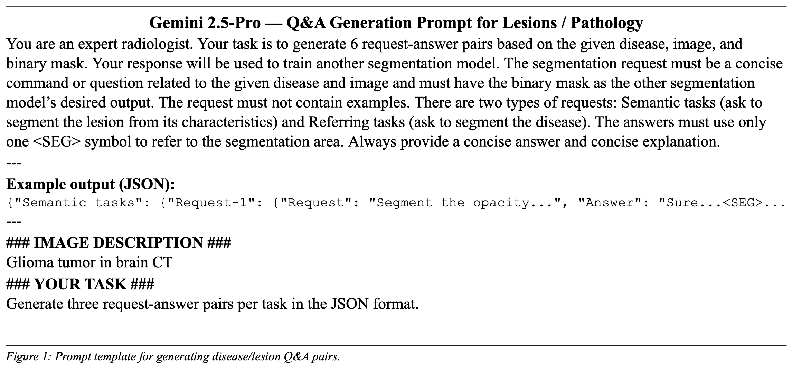
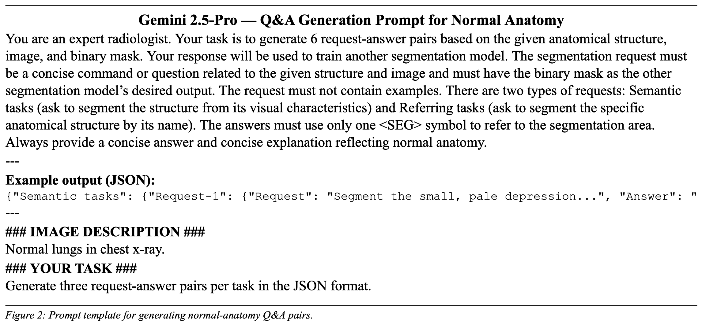
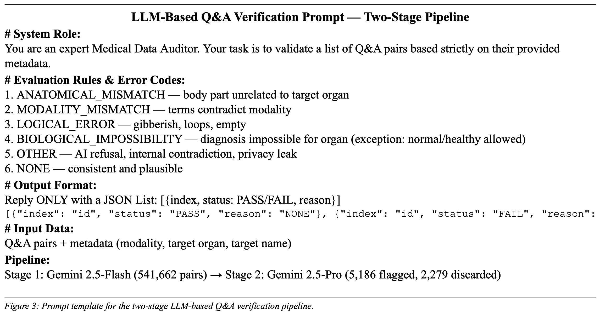

# Med-ReasonSeg Prompts

This directory contains the prompts used to construct the **Med-ReasonSeg** dataset and perform LLM-based quality verification, as described in the MedFuse-Seg paper (MICCAI 2026).

## Prompt Templates

### Q&A Generation — Lesions / Pathology

Used with **Gemini 2.5-Pro** to generate 6 Q&A pairs (3 referring + 3 semantic) per mask for disease and pathology findings.

### Q&A Generation — Normal Anatomy

Used with **Gemini 2.5-Pro** to generate 6 Q&A pairs (3 referring + 3 semantic) per mask for healthy anatomical structures.

### LLM-Based Q&A Verification

Used for both stages of the verification pipeline — identical prompt for **Gemini 2.5-Flash** (Stage 1, bulk screening) and **Gemini 2.5-Pro** (Stage 2, expert re-evaluation).

## File Index

| File | Stage | Model Used | Purpose |
|------|-------|------------|---------|
| `qa_generation_disease.txt` | Q&A Generation | Gemini 2.5-Pro | Lesions / pathology Q&A pairs |
| `qa_generation_normal.txt` | Q&A Generation | Gemini 2.5-Pro | Normal anatomy Q&A pairs |
| `verification.txt` | LLM Verification | Gemini 2.5-Flash → Gemini 2.5-Pro | Two-stage quality control |
